<p align="center">
  
</p>

<p align="center">
  <a href="https://portfolio-gamma-two-d8j6b2mgkq.vercel.app"></a>
  
  
  
  
</p>

<p align="center">
  
</p>

## One portfolio, two universes

A cinematic scroll narrative that opens into a **split screen**. Pick a side and the whole site changes its mind.

| | **TECH** · `/tech` | **CREATIVE** · `/creative` |
|---|---|---|
| Feels like | Circuit boards, warp grids, flow fields | A curved gallery under a dusk sky |
| You get | Products, systems and engineering write-ups | Album-style case studies, a showroom and a discography |
| Built on | Canvas layers, simplex noise, generated circuits | Hit-tested 3D arc, themed sheets, lazy media |

<p align="center">
  
</p>

### The creative side, in short

- **A curved arc of albums.** Every project is an album sleeve with a vinyl peeking out. Cover art was generated on Higgsfield, one unique piece per project, then composed into sleeves.
- **Every album opens a case study.** Each sheet wears its own colours, type and pattern, and breaks the project into the *scopes of work* delivered, with a live example embedded under each one: video, imagery, a browser frame onto the live site, colour systems.
- **The music card is a discography.** Spotify-style Popular list and a grid of the real release artwork, pulled from Apple Music.
- **The showroom.** 115+ pieces in filterable tabs: trailers and ads, episodes, campaign stills, Xs posts and product, brand reels, motion, creator clips and shorts. Videos autoplay muted on screen and open with sound.

| Album | Look | Pattern |
|---|---|---|
| DK2R | Black and antique gold | Stadium floodlight and pitch lines |
| RETRO Studios and Projects | Monochrome | Film strip perforations |
| Ajiwow | Navy and ember | Record grooves, heat scale |
| TOO EASY | Paper white and ink | A hairline grid and nothing else |
| PLASTIVORE | Enzyme green and teal | Hexagon cells |
| AFRO WEEK | Red, gold and green | Flag bands and a sunburst |
| DANFLIX | Streaming red | Film cards |
| First Light | Cream and apricot | Dawn rays, editorial serif |
| TikTok, Streams | Glitch, CRT | Scanlines, split RGB |
| RETRO (music) | Violet on black | Vinyl grooves |

<p align="center">
  
</p>

## How it is built

Three pinned scenes on the main page, assembled in [`app/page.tsx`](app/page.tsx), each using a sticky-backdrop pattern (a full-viewport sticky layer with content flowing over it), scroll-scrubbed with framer-motion `useScroll` and smoothed by Lenis.

| Scene | File | What happens |
|---|---|---|
| 01 Light | [`HeroScene.tsx`](components/scenes/HeroScene.tsx) | Butterfly field, camera push-in, crossfade into the verse card, then the fire |
| 02 Fire | [`FireScene.tsx`](components/scenes/FireScene.tsx) | Album-cover project grid with shared-layout expansion into per-project worlds |
| 03 Dusk | [`DuskScene.tsx`](components/scenes/DuskScene.tsx) | Life blocks, awards, open-to roles, contact |

The split and the two universes live in [`components/universe`](components/universe), the creative gallery in [`components/creative`](components/creative), and all content is data driven:

```text
lib/
  projects.ts            project records and case study copy
  creative/
    works.ts             the cards on the arc
    cases.ts             builds each case study sheet
    scopes.ts            scopes of work with embedded examples
    showroom.ts · xs.ts  the showroom wall
    music.ts             releases and cover art
components/creative/
  ArcGallery.tsx         the curved, draggable 3D arc
  CaseStudySheet.tsx     one sheet, eleven themes
  Showroom.tsx           tabs, lazy video, lightbox
scripts/
  showroom/encode.sh     ffmpeg pipeline for web video and posters
  readme/make-assets.py  builds the animated art in /docs
```

### Engineering notes

- **Performance.** About 160 KB first-load JS and one eager hero image. Everything below the fold is lazy and per-world assets load only when a case study opens. Animation is transform and opacity only: the fire dying is a pre-graded copy of the frame cross-faded on opacity, not a `filter` animated per frame, which measured 27.8 ms to 18 ms median frame time at 4x CPU throttle.
- **Media pipeline.** Everything is encoded for the web with one script: images to WebP, video to 540p or 720p H.264 with AAC audio and a poster frame. Tiles stay muted and load on scroll, and the lightbox plays with sound.
- **3D hit-testing.** Clicks inside the arc are resolved by point, so a card opens even when the 3D scene is what the browser reports under the cursor.
- **Accessibility.** Focus-trapped dialogs with Esc handling, `prefers-reduced-motion` fallbacks per scene, labels throughout.
- **Documents.** `public/cv.pdf` plus `public/cv-creative.pdf`, generated from the same verified project data by [`scripts/generate-cv.js`](scripts/generate-cv.js).

## Run it

```bash
npm ci
npm run dev        # http://localhost:3000
npm run build      # production build
```

Re-encode a clip for the showroom, then rebuild the README art:

```bash
bash scripts/showroom/encode.sh "path/to/clip.mp4" my-clip 40
python scripts/readme/make-assets.py
```

## Work this repo points at

| Project | Source |
|---|---|
| TOO EASY | [`too-easy`](https://github.com/sameermotwani17-cell/too-easy) |
| AFRO WEEK 2026 | [`millennium-hall-booking`](https://github.com/sameermotwani17-cell/millennium-hall-booking) |
| MIRU | [`miru-frontend`](https://github.com/sameermotwani17-cell/miru-frontend) · [`miru-backend`](https://github.com/sameermotwani17-cell/miru-backend) |
| GitHub agent | [`retro_github_agent`](https://github.com/sameermotwani17-cell/retro_github_agent) |

<p align="center">
  
</p>

<p align="center">
  <a href="https://www.linkedin.com/in/sameer-motwani-2625a62b5/">LinkedIn</a> ·
  <a href="https://github.com/sameermotwani17-cell">GitHub</a> ·
  <a href="https://www.instagram.com/retro.studios_">Instagram</a> ·
  <a href="https://www.tiktok.com/@retro.studios">TikTok</a> ·
  <a href="https://open.spotify.com/artist/2vNpaYQTU7PNUh3BjOx07b">Spotify</a>
</p>

<p align="center"><sub>Personal portfolio. All rights reserved. The code structure may be referenced for learning.</sub></p>
